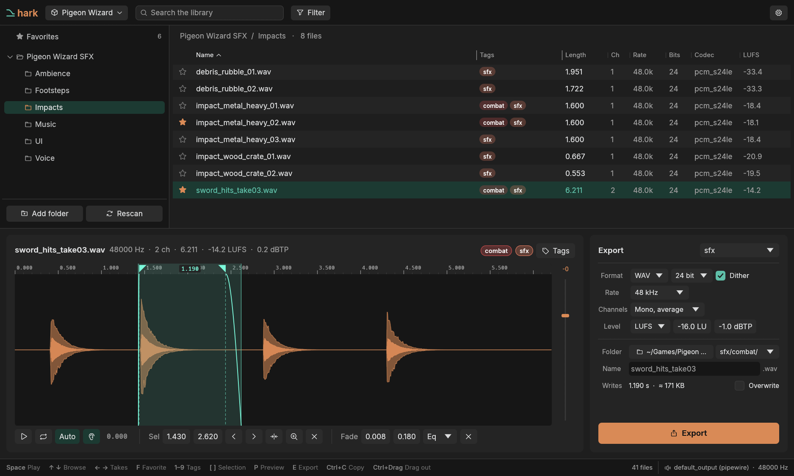
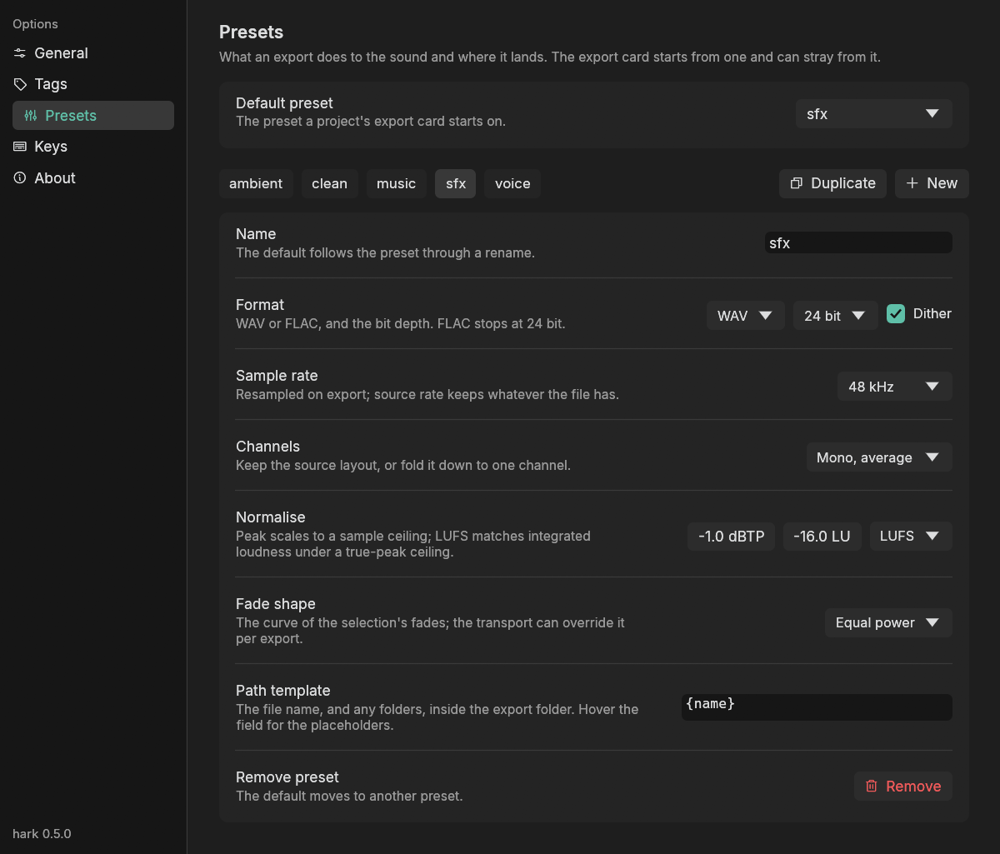

**Listen fast, export clean.** A local sound library browser for game audio, film and video post, apps, theatre, podcasts and sample packs.



kuulo sits between your sound libraries and the project they feed. Point it at the folders your libraries live in, arrow through them at keyboard speed, star and tag what works, select the part you want on the waveform, and export it through a preset into the project's audio folder with a consistent name, format and loudness. Every exported file carries a record of where it came from and how it was made, inside the file itself.

Linux (Wayland) first, with Windows and macOS builds from the same code. No accounts, no cloud. Free software under the GPL.

## Why

Auditioning a large library in a DAW means importing first, and in a file manager means waiting for a player; neither remembers what you liked. Exporting by hand gives a different level and format each time, and leaves a file in the project with no link back to the pack it came from. kuulo does the whole loop in one window and writes the link into the file.

## What it does

- **Instant audition.** Each file plays as the selection lands on it. Neighbours are pre-decoded and waveforms cached, and hour-long recordings stream from disk.
- **A library, not an import.** Folders stay where they are and are never modified. Search and filter by name, favorite, tag, type and channel count, and keep a few standing views in tabs, each with its own folder, search, filter and file. Reads WAV, FLAC, AIFF, MP3, Ogg Vorbis, AAC/M4A, CAF and Matroska audio.
- **Favorites, tags and projects.** Tags are yours to define. Marks follow the file's content, so a renamed or moved file keeps them. A `.kuulo` project file beside your game, edit or show holds its own library folders, output folder and favorites.
- **Waveform selection with fades.** Select a region, trim it to the sound, step through the takes a recording holds, and set fade in and out. Pick the channels to keep beside the wave: one mic of a pair, the good side of a file with a dead one, channel 3 of a six-channel take. Reverse the file for a swell or a pre-impact, heard, drawn and exported backwards, and select inside it as it is heard.
- **Preset-driven export.** WAV or FLAC, bit depth with dither, resampling, mono downmix, peak or EBU R128 loudness normalisation under a true-peak ceiling, and a file name template; any of it can be overridden for one export. Preview plays and draws the sound as the preset would export it, folded to mono and at its normalised level, the selection's with its fades when there is one.
- **An origin inside every export.** A RIFF chunk and BWF `bext` description in WAV, an APPLICATION block and Vorbis comment in FLAC: source path and hash, selection, channels, reverse, fades, preset and applied gain. `kuulo-cli inspect` reads it back and `kuulo-cli reexport` runs the recipe again with changes. A sidecar is never the only copy.
- **Into a DAW directly.** Ctrl-drag (Option-drag on macOS) the selection out of the waveform into Reaper, Pro Tools or a folder, or copy it with Ctrl+C (Cmd+C) and paste. The file is written through the export preset into a copy folder that kuulo never empties on its own, since a DAW may reference it in place; the drag starts once it is written, so hold the button until then; on a long selection that takes a moment.
- **A CLI for all of it.** `kuulo-cli` sits on the same core as the window, with `--json` on every command, so a script or an agent can search, mark, analyse and export without a window.



## Install

Download kuulo for Linux x86_64, Windows x86_64 or macOS (universal) from the [Releases](../../releases) page.

- **Linux:** `install.sh` in the archive puts `kuulo` and `kuulo-cli` in `~/.local/bin` and installs the desktop entry and icon.
- **Windows:** unzip and run `kuulo.exe`. kuulo is not code-signed yet, so Windows may say it protected your PC: choose More info, then Run anyway.
- **macOS:** open the disk image and drag kuulo to Applications. kuulo is not notarized by Apple, so macOS blocks the first launch. Within an hour of that attempt, open System Settings → Privacy & Security, choose Open Anyway beside the note about kuulo, and confirm with your password; from then on it opens like any other app. `kuulo-cli` is inside the app: add `export PATH="/Applications/kuulo.app/Contents/MacOS:$PATH"` to `~/.zprofile` to run it from a terminal.

On Linux, dragging out and clipboard copy need Wayland; everything else runs on all three.

### From source

Rust stable, then:

```
cargo build --release
```

This builds `target/release/kuulo` (the window) and `target/release/kuulo-cli`. `packaging/install.sh` installs the desktop entry and icon for a source build. On Linux the build needs the PipeWire and ALSA headers: `pipewire` on Arch; `libpipewire-0.3-dev libasound2-dev libclang-dev pkg-config libxkbcommon-dev libwayland-dev libgl-dev` on Debian and Ubuntu. Playback uses PipeWire natively and falls back to ALSA. Windows builds with the MSVC or GNU toolchain.

## Getting started

Start `kuulo`, add a library folder with the button under the folder tree, pick a folder and arrow through the files. The status bar shows the main keys; the settings window's Keys page lists every action and rebinds them. To export, choose an output folder and a preset on the export card and press E.

For a project, create one from the project menu in the top bar or with `kuulo-cli projects new`. `kuulo --open <file>` starts on a file and `kuulo --project <file.kuulo>` opens a project.

## The CLI

```
kuulo-cli projects new ~/Projects/game/MyGame.kuulo --output ~/Projects/game/Assets/Audio
kuulo-cli roots add ~/Audio/Libraries --name libraries
kuulo-cli scan
kuulo-cli search footstep gravel --tag foley --channels mono
kuulo-cli tag ~/Audio/Libraries/Footsteps/gravel_03.wav +sfx +foley
kuulo-cli export ~/Audio/Libraries/Footsteps/gravel_03.wav --preset sfx --in 0.2 --out 1.4 --fade-out 0.1 --into footsteps
kuulo-cli inspect ~/Projects/game/Assets/Audio/footsteps/gravel_03.wav
kuulo-cli reexport ~/Projects/game/Assets/Audio/footsteps/*.wav --preset voice
```

`kuulo-cli --help` lists every command. What `inspect` shows for an export:

```
$ kuulo-cli inspect Assets/Audio/sfx/combat/impact_metal_heavy_02.wav
  wave pcm_s24le · 48000 Hz · 1 ch · 24 bit · 1.600s
  bext: kuulo: Pigeon Wizard SFX:Impacts/impact_metal_heavy_02.wav
  origin: kuulo: Pigeon Wizard SFX:Impacts/impact_metal_heavy_02.wav
    exported 2026-10-15T20:08:46+02:00 by kuulo 0.4.0 with preset sfx
    source ~/Audio/Pigeon Wizard/Impacts/impact_metal_heavy_02.wav (230480 bytes, blake3 a1e93ed24193076e)
    fades 0.000s / 0.000s · gain -1.33 dB (true-peak limited)
```

The same record is stored as JSON, readable by anything that walks RIFF chunks or FLAC metadata blocks.

## Where things live

On Linux, settings, tags and presets are in `~/.config/kuulo/config.json`; the library database (`library.sqlite`) and the default copy folder (`copies/`) are in `~/.local/share/kuulo`; waveform peaks are cached in `~/.cache/kuulo/peaks`. Windows and macOS use their platform equivalents; `kuulo-cli config --path` prints the config file's location. The database indexes your folders and holds your tags and favorites; your audio files are never written to.

## Contributing

The workspace is one core library (`crates/kuulo-core`) with two thin frontends, the window (`crates/kuulo`) and the CLI (`crates/kuulo-cli`). [AGENTS.md](AGENTS.md) describes the layout and the invariants a change must keep; [ROADMAP.md](ROADMAP.md) holds the ideas that have been weighed.

## Licence

GPL-3.0-or-later. kuulo is free software: use it, share it and change it, and pass on the source with any copy you distribute. Copyright © 2026 Steffan Poulsen.
